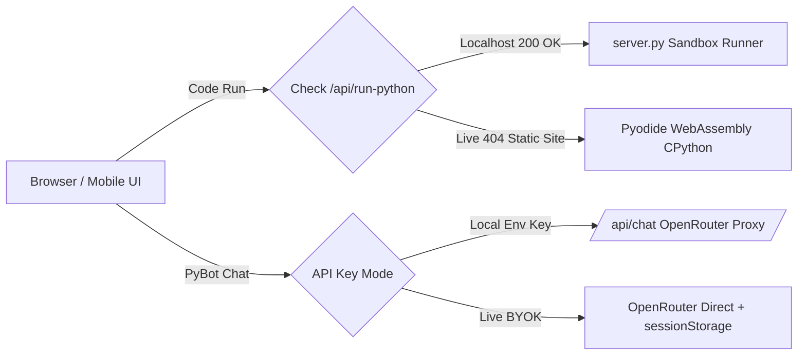

**Author:** Nishant Kumar

**Branch:** CSEAI

**Roll:** 26CSEAI42


# PyConcept — Python Sets & OOP Visual Lab

[](https://pyconcept.neeshant.in/)
[](https://pyodide.org/)
[](https://threejs.org/)
[](#3-100-question-quiz--test-bureau)

An interactive **2D + 3D WebGL visual learning studio** and **live Python 3 online compiler** focused strictly on **Topic 14 (Python Sets)** and **Topic 23 (Object-Oriented Programming)** — featuring a neo-brutalist editorial UI inspired by Mass Bunk Bureau & Apple iOS glass touches, built as a zero-build static web app with an optional hardened Python backend (`server.py`).

> **Live Website:** [https://pyconcept.neeshant.in/](https://pyconcept.neeshant.in/)  
> **Repository:** [https://github.com/sudonishant/Pyconcept](https://github.com/sudonishant/Pyconcept)

---

## Start with one topic (event presentation)

Use **Start 2-minute Sets lesson** or **Start 2-minute OOP lesson** on Home.
Each has an independent prediction, code/state/output trace, Back/Next/Play/Reset,
step-delay slider and focus view. Neither requires a Python runtime download or API.
The full editable labs remain separate and available after the guided example.

- `learning-core.js`: bounded parser, safe syntax rendering and pure set helpers.
- `learning-guide.js` / `.css`: independent, prepared teaching traces and responsive styling.
- Visual traces model a supported subset; they are **not Python interpreters**.
  Demo IDs and opcode-style labels are illustrative, not measured memory or bytecode.
- **Run Python 3** is the separate interpreter route for general edited code.
- See [event checklist and honest test scope](EVALUATION.md).

### Run locally and test

```sh
python3 -m http.server 8050 --bind 0.0.0.0
# Open http://localhost:8050 in a browser
node --test tests/learning.test.cjs
```

The test command needs Node.js 20+ and Python 3. It checks parsing, escaping,
independent lesson fixtures, inline script syntax and real-Python lesson outputs.
The static server does not enable the optional backend APIs.

## Architecture Overview (Hybrid Execution)

PyConcept runs seamlessly on **both static hosting (Vercel)** and **local Python (`server.py`)**:



---

## Core Modules & Features

### 1. Topic 14 — Sets & Venn Studio (`#page-sets`)
- **12 Interactive Concepts (`SET_CONCEPTS`):**
  1. Set Idea (`∈` well-defined vs ambiguous)
  2. Roster Form vs Set-Builder Filter Machine
  3. Elements & Notation (`∈` vs `∉`)
  4. Types of Sets (Empty `∅`, Singleton, Finite, Infinite, Equal vs Equivalent, Disjoint)
  5. Subset (`⊆`) vs Proper Subset (`⊂`)
  6. Universal Set (`U`)
  7. Power Set `P(A)` Decision Tree (`2ⁿ`)
  8. Venn Operations (`∪`, `∩`, `−`, `A'`)
  9. Set Identities & Laws
  10. Cardinality Formula (`n(A ∪ B) = n(A) + n(B) − n(A ∩ B)`)
  11. Number Line Intervals (`[ ]` vs `( )`)
  12. Cartesian Product (`A × B`)
- **2D SVG & 3D WebGL Multi-Venn Diagrams:** Switch between `2-Set Venn`, `3-Set Venn`, `Subset`, and `Disjoint` views. In `2-Set` mode, elements entered in `#sim-set-a` and `#sim-set-b` sync directly onto the **2D SVG Venn diagram** (with operation shading) and **5-part sculptural 3D data block tokens** with a floating 3D result plaque.
- **Illustrative Step-by-Step Set Tracer:** Displays syntax-highlighted code lines, live progress bar, CPython opcodes (`BUILD_SET`, `BINARY_OR`, `BINARY_AND`, `BINARY_SUBTRACT`, `BINARY_XOR`), Time Complexity (`O(min(len(A), len(B)))`), and element-by-element hash bucket evaluation.

### 2. Topic 23 — Object-Oriented Programming (`#page-oop`)
- **Blueprint Stamp Press (3 Modes):**
  - `✍️ Custom`: Enter your own Student `Name`, `Branch / Course`, and `Roll #` to stamp a custom object.
  - `⚡ Auto`: Cycles through pre-styled emoji students (`⚡ Aarav`, `🎨 Diya`, `🎧 Kabir`, `🚀 Riya`, `🤖 Meera`, `🌿 Neha`).
  - `💻 From Code`: Stamps instances parsed directly from `#oop-editor`.
- **The 4 Pillars + Advanced OOP Guide:** Includes definitions, Student-themed Python snippets, and common-mistake warnings for **Inheritance (`super()`)**, **Encapsulation (`__private`)**, **Abstraction (`ABC`)**, **Polymorphism (Overriding)**, Dunder methods (`__str__`, `__repr__`, `__len__`), `@classmethod` / `@staticmethod` / `@property`, and MRO (`__mro__`).
- **OOP Lab (`#oop-lab`):**
  - **2D Student ID Cards (`#oop-obj-panel`):** Renders each live object as a Student ID card with emoji avatar, 2×2 attribute grid, Heap address, `__dict__` count, glowing active attributes, and method call bubbles (`💬 s1.introduce() → "..."`).
  - **3D Hydraulic Stamp & Heap Lab (`#oop-3d-canvas-wrap`):** Interactive Three.js scene with a 720×520 Blueprint Schematic Stamp Press (animated piston + shockwave ring), click-to-flip standing bezel Student Cards, Stack Frame pedestal, and glowing Stack → Heap bezier pointer beams with animated pulse spheres.
  - **Call Frames Tracer:** Live Main Frame vs `__init__` / method stack frame arrows.

### 3. 100-Question Quiz & Test Bureau (`#page-quiz`)
- **100 Curated Questions:** 50 Sets questions + 50 OOP questions (`QUIZ_DATA`).
- **Customizable Sessions:** Choose topic (`Sets`, `OOP`, or `Mixed`), question count (`5`, `10`, `20`, `30`, `50`, or `100`), and countdown timer.
- **Exam Tools:** Question Palette (`not-visited`, `not-answered`, `answered`, `marked`), instant answer explanations, TTS Read Aloud, confetti on completion, and persistent `localStorage` activity logs.

### 4. Real Python 3 Compiler (Local + Browser Pyodide)
- Both Sets Lab and OOP Lab include a syntax-aware editor with line numbers and a **Standard Input (`stdin`)** box for `input()` prompts.
- Click **`⚡ Run Python 3`** to execute arbitrary Python 3 scripts (loops, list comprehensions, `if/else`, functions, custom classes) with real `stdout` and traceback error reporting with line numbers.

### 5. PyBot AI Tutor & Voice Read-Aloud
- Styled strictly in high-contrast **Red (`#ce0505`), White (`#ffffff`), and Black (`#11100f`)**.
- Supports quick topic prompts, context-aware code review from your active editor, and Bring-Your-Own-Key (`BYOK`) OpenRouter API key stored cleanly in `sessionStorage` when hosted statically.

### 6. Mobile Phone, Performance & Accessibility
- **Mobile-First (`360px` & `390px` verified):** Zero horizontal overflow across every view, `16px` mobile form inputs (preventing iOS Safari zoom), `touch-action: none` on 3D canvases for smooth touch orbit, `44px+` thumb targets, and full-width bottom-sheet drawer for PyBot.
- **Fast Loading:** Lazy-loads `Three.js` (`three@0.160.0`) only when clicking `3D Glass`, lazy-loads `Pyodide` (`v0.26.4`) only when needed, and uses only 2 Google Fonts (`Plus Jakarta Sans` + `JetBrains Mono`) with `display=swap`.
- **SEO & Accessibility:** Includes Open Graph & Twitter metadata, `LearningResource` JSON-LD schema, `sitemap.xml`, `robots.txt`, `aria-label` controls, `:focus-visible` outlines, and `@media (prefers-reduced-motion: reduce)`.

---

## Getting Started (Local Development)

### Prerequisites
- Python 3.10+
- Optional for local offline neural/desktop TTS: `pyttsx3` (`pip install pyttsx3`)

### Run Locally
```bash
git clone https://github.com/sudonishant/Pyconcept.git
cd Pyconcept
python3 server.py
```
Then open **[http://127.0.0.1:8095/](http://127.0.0.1:8095/)** in your browser.

---

## Environment Variables (`server.py`)

Create a `.env` file in the project root (already ignored by `.gitignore`) or export variables in your shell:

| Variable | Required | Default | Description |
| --- | --- | --- | --- |
| `OPENROUTER_API_KEY` | No | `""` | Enables the local `/api/chat` proxy for PyBot without entering a key in the UI |
| `PYCONCEPT_API_TOKEN` | No | `""` | If set, requires `X-PyConcept-Token` header on all `POST` requests |

---

## Local Backend API (`server.py`)

| Endpoint | Method | Purpose & Security Hardening |
| --- | --- | --- |
| `/api/health` | `GET` | Returns `{ ok, tts, voices, ai }` capability flags |
| `/api/tts` | `GET` | Synthesizes cached WAV speech audio via `pyttsx3` subprocess (`?text=...&voice=en-us`) |
| `/api/run-python` | `POST` | Runs Python code in an isolated `python3 -I` subprocess (5s timeout, 5000-char code limit, 2000-char `stdin` limit, blocks `os`, `subprocess`, `socket`, `sys`, `shutil`, `open()`, `eval()`, `exec()`) |
| `/api/chat` | `POST` | Proxies chat messages to OpenRouter (`openrouter/free`, `max_tokens: 420`) with IP rate limiting (`20 req/min`) |

Every HTTP response also includes `X-Content-Type-Options: nosniff`, `X-Frame-Options: SAMEORIGIN`, and `Referrer-Policy: strict-origin-when-cross-origin`.

---

## Repository Structure

```text
Pyconcept/
├── index.html    # Single-file studio (HTML, CSS, 12 Set Concepts, OOP 4 Pillars, 2D/3D engines, Pyodide, 100-Q Quiz, PyBot)
├── server.py     # Optional hardened local Python server (/api/run-python, /api/chat, /api/tts, /api/health)
├── favicon.svg   # Vector P badge icon
├── sitemap.xml   # SEO sitemap (/, #sets, #oop, #quiz)
├── robots.txt    # Search engine crawl directives
├── .gitignore    # Excludes .env and Python cache files
└── README.md     # Project documentation
```

---

## Deploying to Vercel (Static)

1. Import `sudonishant/Pyconcept` in Vercel.
2. Leave **Framework Preset** as `Other` and **Build Command** empty (static `index.html` deployment).
3. Deploy — **Python 3 execution** will automatically run in-browser via Pyodide CDN, and **PyBot** will work using users' own OpenRouter keys (`BYOK`).

---

## Troubleshooting

- **First Python run on live Vercel takes ~5–10 seconds:** Pyodide WebAssembly (`~10 MB`) is downloaded lazily from CDN on the first run and cached for instant subsequent executions.
- **OpenRouter 401/402 in PyBot:** Make sure `OPENROUTER_API_KEY` is valid in `.env` (local) or enter an OpenRouter key via the ⚙️ icon in the PyBot header (live static site).
- **3D view is blank:** Ensure hardware/WebGL acceleration is enabled in browser settings (`3D Glass` dynamically loads Three.js on click).
